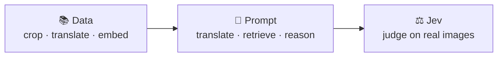

<div align="center">

# 漫画 · manga-multi-modal-rag

**Find manga panels from a lazy hint or a detailed description.**

Multimodal agentic RAG over 82,124 panels from [Manga109-s](https://huggingface.co/datasets/hal-utokyo/Manga109-s).

[Index on HF](https://huggingface.co/datasets/martin76ec/Manga109-s-indexes) · [Demo video](https://www.youtube.com/watch?v=bUYKq-7YVvg)


</div>

---

## How it works



### 1 · Data

| Step | What happens |
| --- | --- |
| **Crop** | Manga109 XML frame boxes become panel crops, each carrying the dialogue and character boxes inside it. |
| **Translate** | Dialogue is translated from Japanese to English for display with `nllb-200-distilled-600M` |
| **Embed** | `line-corporation/clip-japanese-base` embeds the crop and the dialogue into one 512-dim space. |
| **Storage** | Single Parquet index: 87 books, 82,124 panels, about 380 MB. |

### 2 · How does it work?

```
prompt: "someone holding a gun" --> translate into --> "銃を握っている人"  --> generate text embedding --> compare against panel image+dialog embeddings -->  score = 0.6·image + 0.4·text
```

- **Translation** CLIP and the corpus are both Japanese, so English queries are translated before embedding.
- **Blended Retrieval** Image + text similarity, with weights picked by a sweep.
- **Agent Search** A custom MRKL + IRCoT loop on `gemma-4-26B-A4B-it`. Each `Thought` becomes the next search query.

### 3 · Jev as judge

The agent's own judge gave everything 5/5. [Jev](https://typesafe.ai) gets the **cited panel images** along with the question, evidence and answer, and returns:

- `faithfulness`: is every claim backed by the dialogue or by something visible in the panels?
- `relevancy`: 0–2, does the answer address the question?

Its scores were lower and more spread out (0.54–0.68), and it correctly marked an honest "I don't know" as low relevancy.

---

## Quickstart

```bash
uv sync
hf auth login          
uv run anime-rag ask   
```

<sub>Manga109-s has its own non-commercial license. The dataset itself isn't redistributed here.</sub>
